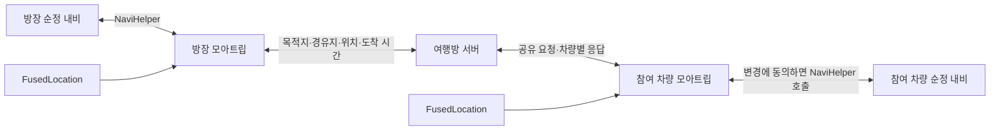

# 모아트립

**각 차량의 순정 내비를 하나의 여행방으로 연결해, 목적지와 경유지를 함께 정하고 일행의 위치와 도착 시간을 확인하는 여행 앱입니다.**

[**▶ 시연 영상 보기**](https://daeho-ai.github.io/moa-trip/) · [**APK 다운로드**](https://github.com/Daeho-AI/moa-trip/raw/refs/heads/main/apk/모아_모아트립_release.apk)

[](https://daeho-ai.github.io/moa-trip/)

## 주요 기능

- **여행방:** 방을 만들고 초대 코드로 일행이 참여합니다.
- **목적지 공유:** 방장이 목적지 변경을 요청하면 다른 차의 순정 내비 위에 알림이 뜹니다. 변경에 동의하면 그 차의 목적지가 바뀝니다.
- **함께 들를 경유지:** 일행에게 들를 곳을 제안하고, 동의한 차량에만 추가합니다. 기존 경유지와 최종 목적지는 유지합니다.
- **일행 위치와 도착 시간:** 차량별 거리와 도착 예정 시간을 보고 어디서 기다리거나 합류할지 정할 수 있습니다.
- **각자의 일정 유지:** 변경을 원하지 않으면 현재 목적지로 계속 갑니다. 여행방 참여와 설정은 주차 후 진행합니다.

## SDK와 기술 구조

| 구성 | 사용하는 기능 | 앱에서 하는 일 |
|---|---|---|
| **Pleos NaviHelper 3.0.5** | 목적지·경유지·도착 예정 시간 조회, `requestRoute`, `addWaypoint` | 목적지와 경유지를 공유하고, 동의한 차량의 순정 내비에 적용합니다. |
| **Pleos FusedLocation 1.1.3** | 위도·경도·방향·위치 수신 시각 | 동의한 차량의 위치를 공유하고 차량 사이의 거리를 계산합니다. |
| **Android Automotive / 알림 API** | 주차·주행 상태, 차량 화면 제한, 알림 버튼 | 주행 상태에 맞게 조작을 제한하고 내비 위에서 변경에 응답합니다. |
| **Kotlin·Compose / FastAPI·WebSocket·SQLite** | 차량 앱과 여행방 서버 | 초대, 공유 설정, 차량별 응답과 이동 정보를 연결합니다. |



내비 변경은 차량별 동의 후에만 실행하고, 실제 목적지와 경유지를 다시 확인해 완료로 표시합니다. 일행 위치는 차량 목록의 거리·도착 정보로 제공합니다. 순정 지도 위 차량 아이콘은 현재 공개 SDK의 지원 범위에 포함되지 않습니다.

## 실행 방법

**화면 확인:** Pleos 에뮬레이터에 APK를 설치하면 시작 화면과 여행방 생성·참여 입력 화면을 볼 수 있습니다. 서버가 연결되지 않은 상태에서 방 만들기나 참여를 누르면 연결 안내가 표시됩니다.

**실제 기능 체험:** Pleos 에뮬레이터 두 대와 PC에서 실행하는 여행방 서버가 필요합니다. 시연 영상은 이 환경에서 촬영했습니다. [Linux 설치·실행 안내](docs/LINUX.md)

1. 저장소를 내려받고 공식 Pleos Connect 에뮬레이터를 준비합니다.
2. 서버를 실행합니다. Windows는 `Start-Server.cmd`, Linux는 `source tools/linux_env.sh` 후 `python3 tools/start_linux_server.py`를 사용합니다.
3. 두 에뮬레이터에 [apk/모아_모아트립_release.apk](apk/모아_모아트립_release.apk)를 설치합니다. Windows에서는 `powershell -ExecutionPolicy Bypass -File tools\install_existing_device.ps1 -Serial emulator-5556`을 실행하고, 다른 기기 번호로 한 번 더 실행합니다. 기기 번호는 `adb devices`로 확인합니다.
4. 위치·알림 권한을 허용합니다. 기본 서버 주소는 `http://10.0.2.2:8766`이며, 에뮬레이터와 같은 PC에서 서버를 실행해야 합니다.
5. 주차 상태에서 방을 만들고 다른 차는 초대 코드로 참여합니다. 각 차량에서 위치·도착 시간 공유를 켜면 사용할 수 있습니다.

별도의 공개 운영 서버는 포함하지 않습니다. 일반 휴대폰에서는 Pleos SDK를 사용할 수 없습니다.

## 테스트 환경

- Pleos Connect 에뮬레이터 **2.1.0**, Android 14 / API 34, x86_64
- 화면 **2560 × 1440, 160 dpi**
- Ubuntu 24.04, KVM, 에뮬레이터 두 대
- Navi Service 3.0.4 / Navigation 3.3.2-rc5-hotfix.3
- 실제 확인: 목적지 변경·거절, 경유지 추가·기존 경유지 보존, 위치·도착 시간 공유

경유지는 최대 2곳입니다. 이 에뮬레이터의 경유지 좌표 누락은 확인한 버전에서 POI ID로 처리합니다. 자세한 재현 조건과 SDK 제약은 [검증 기록](docs/VERIFICATION.md)과 [경유지 안내](docs/WAYPOINTS.md)에 정리했습니다.

## 소스 구성

```text
android/app/   차량 화면 · 여행방 연결 · Pleos SDK 연동
android/core/  목적지 비교 · 변경 동의 · 적용 결과 확인
server/        여행방 API · 실시간 공유 · 데이터 저장
apk/           설치용 release APK
tools/         설치 · 서버 실행 · 빌드 · 검증 도구
```

[소스 빌드](docs/DEVELOPMENT.md) · [순정 내비 연동 범위](docs/NATIVE_NAVIGATION.md)
