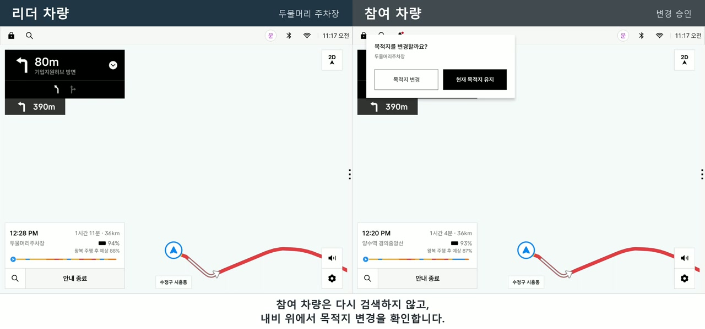
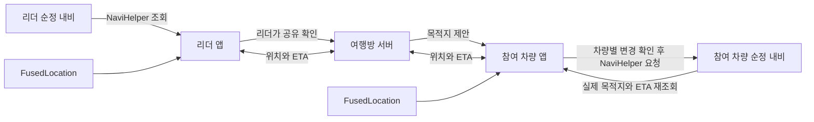

# 모아트립

**차 여러 대로 여행할 때 목적지를 다시 검색하는 수고를 줄이고, 각 차량의 확인을 거쳐 순정 내비 목적지와 도착 정보를 함께 관리합니다.**

[**▶ 시연 영상 바로 보기 — 로그인 없이 브라우저에서 재생**](https://daeho-ai.github.io/moa-trip/)

[](https://daeho-ai.github.io/moa-trip/)

방 만들기 → 초대·공유 설정 → 목적지 공유 → 위치·도착 시간 확인 → 경유지 제안·승인 → 목적지 변경 거절을 실제 에뮬레이터 두 대로 보여줍니다. 상단의 **리더 차량 / 참여 차량** 표시로 두 차량을 구분할 수 있습니다.

Pleos Connect용 Kotlin 앱과 PC에서 실행하는 여행방 서버입니다. **순정 내비를 보던 화면에서 목적지 변경 요청을 받고, 알림의 두 버튼으로 바로 선택합니다.**

일행의 목적지가 바뀔 때마다 주소를 보내고, 각 차가 다시 검색하고, 어디까지 왔는지 연락하는 과정을 줄이려는 앱입니다. 각 차량의 순정 내비에 등록된 목적지와 ETA를 기준으로 함께 이동하는 상황을 조율합니다. 리더가 바꿔도 다른 차량의 내비는 확인 전까지 유지됩니다.

[APK 다운로드](https://github.com/Daeho-AI/moa-trip/releases/download/v0.5.0/moatrip-0.5.0-release.apk) · [영상 파일 저장](https://daeho-ai.github.io/moa-trip/video/moatrip-demo.mp4) · [Linux 실행](docs/LINUX.md) · [검증 결과](docs/VERIFICATION.md)

**독립된 Pleos 에뮬레이터 2대에서 순정 내비 위 알림의 승인·거절과 실제 목적지 반영을 확인했습니다.** 주행 상태에서도 앱을 전면에 열지 않고 처리하며 위치·ETA 공유는 배경에서 이어집니다. 영상은 배포 APK의 실제 조작 녹화입니다. [영상 구성](docs/DEMO.md)

## 차량에서 사용하는 이유

위치·ETA 공유는 [Google Maps](https://support.google.com/maps/answer/15437054?hl=en)에도 있으며, 그룹 위치·메시지 기능은 [Garmin Group Ride](https://www8.garmin.com/manuals/webhelp/GUID-94D95904-F3F7-4AAA-85EE-67751184A60C/EN-US/GUID-72B9F7CF-955E-4488-93AD-70C85CE62F05.html)에도 있습니다. 모아트립의 차량 특화 가치는 **Pleos 순정 내비의 실제 목적지 조회 → 리더의 공유 확인 → 차량별 변경 확인 → 실제 반영 재조회**를 여행방과 연결하는 데 있습니다.

## 무엇을 할 수 있나요?

- 초대 코드로 최대 5대가 같은 여행방에 참여합니다.
- 리더: **일행에게도 변경을 요청할까요?** → `나만 변경` / `일행에게 요청`
- 참여 차량: 장소 확인 → `현재 목적지 유지` / `목적지 변경`
- 승인한 차량만 순정 내비에 변경을 요청합니다. 거절·무응답·재접속만으로는 바뀌지 않습니다.
- 리더가 순정 내비에 경유지를 추가하면 일행에게 함께 들르기를 제안합니다. 승인한 차량만 추가하며 개인 경유지 순서와 최종 목적지는 유지합니다. 최대 2곳이고, 재접속으로 다시 넣지 않습니다. [경유지 동작과 SDK 호환 범위](docs/WAYPOINTS.md)
- 동의한 차량의 위치 갱신 시각·직선 거리·순정 내비 ETA를 목록으로 봅니다.

여행방 생성·입력·공유 설정은 주차 후 마칩니다. 이후 순정 내비 위에 뜨는 알림에서 바로 승인·거절할 수 있습니다. 무응답이면 기존 목적지를 유지합니다. 알림을 놓쳤다면 여행방의 변경 요청을 다시 확인합니다.

**다른 차량의 위치는 여행방 목록에서 확인합니다.** 공개 NaviHelper 3.0.5에는 순정 지도에 임의 차량 마커를 추가하는 API가 확인되지 않아, 순정 지도 위 차량 아이콘은 구현 범위에 포함하지 않습니다. [SDK 범위와 화면 정책](docs/NATIVE_NAVIGATION.md)

## 가장 빠른 실행

**검증한 환경은 Linux 워크스테이션 + Pleos 에뮬레이터 2대입니다.** Windows에서는 SSH로 연결하면 됩니다. [Linux 안내](docs/LINUX.md)에 SDK 설치부터 서버·에뮬레이터·APK 실행까지 순서대로 정리했습니다. 일반 휴대폰에서는 Pleos SDK가 작동하지 않습니다.

Linux 환경 준비 후 첫 터미널에서 `source tools/linux_env.sh` → `python3 tools/start_linux_server.py`, 두 번째 터미널에서 `source tools/linux_env.sh` → `python3 tools/start_linux_emulators.py A B --memory 8192 --nvidia`를 실행합니다. `--nvidia`는 NVIDIA 드라이버를 쓰는 환경용입니다. APK 설치 명령은 Linux 안내에 있습니다.

기존 Windows 설치기를 사용하는 방법은 다음과 같습니다. Windows에서 최종 두 대 동시 시연까지 재검증한 것은 아닙니다.

1. 저장소를 내려받아 **`D:\Codex\moa-trip`**에 압축을 풉니다.
2. `Start-Server.cmd`를 실행하고 창을 유지합니다. 첫 실행에서 Python 의존성을 설치합니다.
3. Pleos 에뮬레이터를 켜고 P 상태에서 순정 내비 초기화를 마칩니다. 장소는 **새 검색 결과**에서 고릅니다.
4. `Install-App.cmd`를 실행합니다. Android SDK를 찾지 못하면 `ANDROID_HOME`을 SDK 설치 폴더로 지정합니다.
5. 앱에서 위치·알림 권한을 허용하고 **여행방 만들기 → 참여 설정 → 위치·도착 시간 공유**를 선택합니다.
6. 다른 에뮬레이터에 같은 APK를 설치해 초대 코드로 참여합니다. 리더가 목적지를 정하고 요청하면 각 차량에서 변경 여부를 선택합니다.

서버 주소는 공식 Pleos 에뮬레이터에서 `http://10.0.2.2:8766`입니다. 외부 기기 연결은 `연결 설정`에 HTTPS 서버 주소를 입력합니다. 공개 서버는 포함하지 않습니다.

여러 에뮬레이터가 실행 중이면 설치 대상을 지정하세요.

```powershell
.\tools\install_existing_device.ps1 -Serial emulator-5556
.\tools\install_existing_device.ps1 -Serial emulator-5558
```

이전 debug 앱과 release 앱의 서명이 달라 설치가 실패하면 시험용 debug 앱을 제거한 뒤 설치합니다. 제거하면 그 기기의 여행방 로그인·설정이 초기화됩니다.

이 프로젝트의 전용 에뮬레이터를 자동으로 만들고 실행하려면 `Start-MoaTrip.cmd`, 두 대는 `Start-Two-Cars.cmd`를 사용합니다. 공식 Pleos 이미지가 SDK 안에 설치돼 있어야 하며 두 대 실행은 메모리를 많이 사용합니다.

## 어떤 SDK를 어떻게 쓰나요?

| 구성 | 실제 사용하는 정보·호출 | 역할 |
|---|---|---|
| **NaviHelper 3.0.5** | `getDestinationInfo`, `getWaypointInfo`, `getRouteStateInfo`, 변경 콜백 | 순정 목적지·경유지·경로 옵션·ETA 읽기 |
| **NaviHelper 3.0.5** | `requestRoute`, 호환되는 경유지가 있으면 `requestRouteWithWaypoints` | 이번 요청을 승인한 차량의 목적지 등록 |
| **NaviHelper 3.0.5** | `addWaypoint`, `getWaypointInfo` | 차량별 승인 후 공동 경유지 추가·반영 재조회 |
| **FusedLocation 1.1.3** | 위치 콜백, `getLastKnownLocation` | 위도·경도·방향·표본 시각 수신 |
| **Android Automotive API** | `CarUxRestrictionsManager`, `CarPropertyManager` 기어 조회 | 주행 제한과 주차 후 설정 적용 |
| **Android 알림 API** | 높은 중요도의 내비 알림, immutable `PendingIntent`, 비공개 수신기 | 순정 내비 위에서 리더 요청·차량별 승인/거절. 화면 전환 없이 동일한 확인 검증 경로 호출 |
| **자체 FastAPI 서버** | REST, WebSocket, SQLite | 방·초대·동의·목적지 제안·위치·ETA 전달 |

Pleos SDK는 위 **2종**을 사용합니다. AAOS API는 별도 플랫폼 API입니다. Vehicle·STT·TTS SDK를 사용한 것으로 표시하지 않습니다. 내비 요청 성공은 안내 시작과 다르며, 실제 목적지·경유지 재조회가 일치해야 등록 완료로 표시합니다.



## 테스트 환경과 범위

- **Pleos Connect 에뮬레이터 2.1.0**, Android 14 / API 34, x86_64.
- Ubuntu 24.04 워크스테이션, KVM, 전용 AVD 2대(각 8 GB). Windows에서 SSH로 실행·녹화할 수 있습니다. [Linux 설치·실행 안내](docs/LINUX.md)
- **2560 × 1440, 160 dpi**. 넓은 창은 목적지·차량 목록 2열, 좁은 창은 세로 배치.
- Navi Service 3.0.4 / 순정 Navigation 3.3.2-rc5-hotfix.3.
- `apk/모아_모아트립_release.apk`: release 빌드, 자체 서명. 마켓 출시용 인증을 뜻하지 않습니다.
- 실제 SDK 앱이며 연결 실패 시 가짜 위치·목적지로 대체하지 않습니다. 현재 검증 완료 범위와 재검증이 필요한 부분은 [검증 기록](docs/VERIFICATION.md)에 있습니다.

현재 구현은 여행방·목적지 변경 확인·경유지 함께 들르기·위치/ETA 목록입니다. 자체 지도, 휴게소 추천, 픽업 최적화, 이모티콘은 후속 범위입니다. 좌표가 없는 경유지의 추가는 확인한 에뮬레이터의 POI ID 호환 처리로 구분합니다. 그런 경유지가 남은 상태에서 최종 목적지를 바꾸는 요청은 경유지를 지우지 않고 보류합니다. [정확한 호환 범위](docs/WAYPOINTS.md)

검사한 Connect 2.1.0의 기본 최근 목적지와 현재 검색 결과가 다른 사례가 있었습니다. 실제 등록 결과가 요청한 위치와 다르면 **‘순정 내비 확인 필요’**로 표시하고 ETA 집계·추가 자동 요청을 보류합니다. 최근 목록 대신 새 검색을 사용하는 재현 조건과 상세 결과는 검증 기록에 있습니다.

## 첫 사용자와 확장 계획

초기 대상은 Pleos 차량 2~5대로 함께 여행하는 가족·친구·캠핑 모임입니다. 오너 모임과 캠핑 모임에서 소규모 사용을 검증하고, 방장의 초대 코드가 일행 참여로 이어지는지를 확인할 계획입니다. 여행 앱의 특성에 맞게 목적지 재검색·확인 연락 횟수, 초대 후 참여율, 다음 여행의 재사용률을 측정합니다. 아직 실사용자 MAU·유지율 실적은 없습니다.

기본 여행방을 검증한 뒤 반복 여행 관리, 휴게소 추천과 픽업 최적화로 확장합니다. 향후 단체 여행 운영자의 관리 기능을 유료화할 수 있는지 검증할 계획이며, 계약이나 수익이 확보된 상태는 아닙니다. 현재는 각 참여 차량에 Pleos 앱과 서버 연결이 필요합니다. 일반 휴대폰 참여, 운영 서버와 유료 기능은 구현 전입니다.

## 소스 구조와 빌드

```text
android/app/      Compose 화면 · 여행 컨트롤러 · Pleos SDK 어댑터
android/core/     목적지 비교 · 확인 유효성 · 내비 반영 판정
server/          여행방 API · WebSocket · 데이터 저장
apk/             제출용 release APK와 SHA-256
tools/           서버·설치·빌드·검증 실행기
docs/            SDK 사용 범위 · 검증 · 확장 설계
```

소스 빌드에는 **JDK 17, Android SDK 35**가 추가로 필요합니다. SDK 의존성은 Pleos 공식 Maven 저장소에서 가져옵니다.

```powershell
.\tools\setup_server.ps1
.\tools\build.ps1 -Tasks ':app:assembleDebug',':core:test'
.\tools\build_release.ps1
```

서명키는 첫 release 빌드 때 `work/signing/`에 생성하며 Git에 포함하지 않습니다. 새 키로 빌드한 앱은 기존 배포 APK 위에 업데이트할 수 없습니다. 다른 환경에서의 수동 빌드와 서버 실행은 [개발 안내](docs/DEVELOPMENT.md)를 참고하세요.
