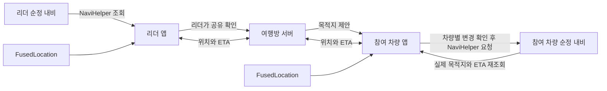

# 모아트립

**차 여러 대로 떠나는 여행에서, 목적지는 확인하고 함께 바꾸고 위치와 도착 시간은 한곳에서 봅니다.**

Pleos Connect용 Kotlin 앱과 PC에서 실행하는 여행방 서버입니다. 리더가 순정 내비 목적지를 공유하면 각 차량은 변경 여부를 직접 선택합니다.

[APK 다운로드](https://github.com/Daeho-AI/moa-trip/releases/download/v0.4.1/moatrip-0.4.1-release.apk) · [시연 영상](https://github.com/Daeho-AI/moa-trip/releases/download/v0.4.1/moatrip-demo.mp4) · [SDK 연결 상세](docs/IMPLEMENTATION.md) · [검증 결과](docs/VERIFICATION.md)

영상은 실제 시작 화면과 **예시 데이터 기반 프로토타입**을 함께 보여줍니다. 확인 버튼부터 실제 순정 내비 반영까지의 최종 검증은 남아 있습니다. [영상 구성](docs/DEMO.md)

## 무엇을 할 수 있나요?

- 초대 코드로 최대 5대가 같은 여행방에 참여합니다.
- 리더: **일행에게도 변경을 요청할까요?** → `나만 변경` / `일행에게 요청`
- 참여 차량: 장소 확인 → `현재 목적지 유지` / `목적지 변경`
- 승인한 차량만 순정 내비에 변경을 요청합니다. 거절·무응답·재접속만으로는 바뀌지 않습니다.
- 동의한 차량의 위치 갱신 시각·직선 거리·순정 내비 ETA를 목록으로 봅니다.

주행 중에는 짧은 확인 창을 사용하고, 여행방 생성·입력·설정은 주차 후 사용합니다. 앱이 배경에 있으면 알림을 열어 변경을 확인합니다. 순정 지도 위에 다른 차량 마커를 그리는 기능은 포함하지 않습니다.

## 가장 빠른 실행

**Windows + Python 3.10 이상 + Pleos Connect 에뮬레이터**가 필요합니다. 일반 휴대폰에서는 Pleos SDK가 작동하지 않습니다. 에뮬레이터는 [공식 개발 문서](https://document.pleos.ai/)에 따라 설치합니다.

1. 저장소를 내려받아 **`D:\Codex\moa-trip`**에 압축을 풉니다.
2. `Start-Server.cmd`를 실행하고 창을 유지합니다. 첫 실행에서 Python 의존성을 설치합니다.
3. Pleos 에뮬레이터를 켜고 P 상태에서 순정 내비 초기화를 마칩니다.
4. `Install-App.cmd`를 실행합니다. Android SDK를 찾지 못하면 `ANDROID_HOME`을 SDK 설치 폴더로 지정합니다.
5. 앱에서 위치·알림 권한을 허용하고 **여행방 만들기 → 참여 설정 → 위치·도착 시간 공유**를 선택합니다.
6. 다른 에뮬레이터에 같은 APK를 설치해 초대 코드로 참여합니다. 리더가 목적지를 정하고 요청하면 각 차량에서 변경 여부를 선택합니다.

서버 주소는 공식 Pleos 에뮬레이터에서 `http://10.0.2.2:8766`입니다. 외부 기기 연결은 `연결 설정`에 HTTPS 서버 주소를 입력합니다. 공개 서버는 포함하지 않습니다.

여러 에뮬레이터가 실행 중이면 설치 대상을 지정하세요.

```powershell
.\tools\install_existing_device.ps1 -Serial emulator-5556
.\tools\install_existing_device.ps1 -Serial emulator-5558
```

이전 debug 앱과 release 앱의 서명이 달라 설치가 실패하면 시험용 debug 앱을 제거한 뒤 설치합니다. 제거하면 그 기기의 여행방 로그인·설정이 초기화됩니다.

이 프로젝트의 전용 에뮬레이터를 자동으로 만들고 실행하려면 `Start-MoaTrip.cmd`, 두 대는 `Start-Two-Cars.cmd`를 사용합니다. 공식 Pleos 이미지가 SDK 안에 설치돼 있어야 하며 두 대 실행은 메모리를 많이 사용합니다.

## 어떤 SDK를 어떻게 쓰나요?

| 구성 | 실제 사용하는 정보·호출 | 역할 |
|---|---|---|
| **NaviHelper 3.0.5** | `getDestinationInfo`, `getWaypointInfo`, `getRouteStateInfo`, 변경 콜백 | 순정 목적지·경유지·경로 옵션·ETA 읽기 |
| **NaviHelper 3.0.5** | `requestRoute`, 호환되는 경유지가 있으면 `requestRouteWithWaypoints` | 이번 요청을 승인한 차량의 목적지 등록 |
| **FusedLocation 1.1.3** | 위치 콜백, `getLastKnownLocation` | 위도·경도·방향·표본 시각 수신 |
| **Android Automotive API** | `CarUxRestrictionsManager`, `CarPropertyManager` 기어 조회 | 주행 제한과 주차 후 설정 적용 |
| **자체 FastAPI 서버** | REST, WebSocket, SQLite | 방·초대·동의·목적지 제안·위치·ETA 전달 |

Pleos SDK는 위 **2종**을 사용합니다. AAOS API는 별도 플랫폼 API입니다. Vehicle·STT·TTS SDK를 사용한 것으로 표시하지 않습니다. 내비 요청 성공은 안내 시작과 다르며, 실제 목적지·경유지 재조회가 일치해야 등록 완료로 표시합니다.



## 테스트 환경과 범위

- **Pleos Connect 에뮬레이터 2.1.0**, Android 14 / API 34, x86_64.
- **2560 × 1440, 160 dpi**. 넓은 창은 목적지·차량 목록 2열, 좁은 창은 세로 배치.
- Navi Service 3.0.4 / 순정 Navigation 3.3.2-rc5-hotfix.3.
- `apk/모아_모아트립_release.apk`: release 빌드, 자체 서명. 마켓 출시용 인증을 뜻하지 않습니다.
- 실제 SDK 앱이며 연결 실패 시 가짜 위치·목적지로 대체하지 않습니다. 현재 검증 완료 범위와 재검증이 필요한 부분은 [검증 기록](docs/VERIFICATION.md)에 있습니다.

현재 구현은 여행방·변경별 확인·위치/ETA 목록입니다. 자체 도로 지도, 공동 휴게소, 픽업 최적화, 이모티콘은 후속 개발 범위입니다. 호환성이 확인되지 않은 개인 경유지는 지우지 않고 변경 요청을 보류합니다.

## 소스 구조와 빌드

```text
android/app/      Compose 화면 · 여행 컨트롤러 · Pleos SDK 어댑터
android/core/     목적지 비교 · 확인 유효성 · 내비 반영 판정
server/          여행방 API · WebSocket · 데이터 저장
apk/             제출용 release APK와 SHA-256
tools/           서버·설치·빌드·검증 실행기
docs/            SDK 사용 범위 · 검증 · 확장 설계
```

소스 빌드에는 **JDK 17, Android SDK 35**가 추가로 필요합니다. SDK 의존성은 Pleos 공식 Maven 저장소에서 가져옵니다.

```powershell
.\tools\setup_server.ps1
.\tools\build.ps1 -Tasks ':app:assembleDebug',':core:test'
.\tools\build_release.ps1
```

서명키는 첫 release 빌드 때 `work/signing/`에 생성하며 Git에 포함하지 않습니다. 새 키로 빌드한 앱은 기존 배포 APK 위에 업데이트할 수 없습니다. 다른 환경에서의 수동 빌드와 서버 실행은 [개발 안내](docs/DEVELOPMENT.md)를 참고하세요.
