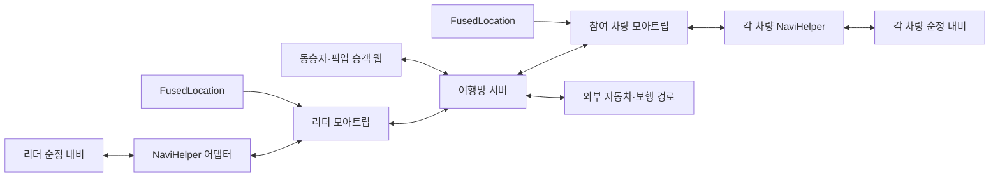

# 모아트립 구조와 동기화 계약

**v0.4 우선 규칙:** 리더의 공유 확인과 각 차량의 목적지 변경 확인이 매번 필요하다. 이전 자동 따라가기 동의로 내비를 쓰지 않는다. 현재 화면·동작은 [REVIEW_02](REVIEW_02.md)와 [IMPLEMENTATION](IMPLEMENTATION.md)을 따른다. 나머지 확장 설계는 구현 완료를 뜻하지 않는다.

v0.2 · 사용자 관점 보정. 제품 계약이며 실행 완료 명세가 아니다.

0.3의 실제 구현은 app/core 모듈, SharedPreferences+Keystore, FastAPI+SQLite+WebSocket으로 첫 목적지/위치/ETA 흐름을 만든다. 아래 전체 구조 중 구현한 부분과 차이는 [IMPLEMENTATION.md](IMPLEMENTATION.md)를 따른다.

## 1. 구성

Android는 Kotlin·Jetpack Compose·Coroutines·Room·OkHttp를 사용한다. SDK와 도메인 규칙을 분리해 실제 차량 어댑터와 fixture 어댑터를 바꿔 끼운다. 서버는 Python FastAPI·SQLite WAL·WebSocket으로 시작한다. 초기 한 프로세스의 방별 이벤트 전달을 사용하며, 수평 확장이 필요해지면 PostgreSQL·Redis로 옮긴다. 첫 버전에서 여러 웹 워커를 켜고 메모리 이벤트가 자동 공유된다고 가정하지 않는다.

동승자·승객 웹은 TypeScript의 가벼운 모바일 화면으로 제공한다. 웹 자체가 Pleos SDK를 호출하지 않는다. 서버를 통해 승인된 방·픽업 건의 정보만 이용한다. 실제 휴대폰 위치 사용에는 HTTPS와 브라우저 권한이 필요하다.

로컬 개발 서버는 **8766 포트**를 사용해 기존 RPG 서버와 구분한다. 실제 SDK 앱 `dev.moa.trip`, fixture 앱 `dev.moa.trip.fixture`를 분리한다. LIVE에서 외부 키나 SDK가 없으면 기능 불가 상태를 보여주며 가짜 데이터로 자동 대체하지 않는다.

## 2. 앱 모듈과 책임

| 모듈 | 책임 |
|---|---|
| core-model | PlaceRef, RoomPlan, PersonalPlan, Telemetry, SyncReceipt, PickupJob |
| core-sync | 리더 변경 감지, 계획 버전, 개인 경유지 합성, 충돌·재연결 |
| core-pickup | 시간 계산, 걷기·대기 필터, 후보 순위 |
| platform-pleos | NaviHelper·FusedLocation·TTS·AAOS 어댑터 |
| data-room | 서버 인증·WebSocket·복구·Room 캐시 |
| feature-trip | 여행방·지도·차량별 ETA |
| feature-stops | 공동 휴게소·준비 확인 |
| feature-pickup | 승객 초대·후보 비교·동의·경유지 반영 |
| feature-reactions | 프리셋·스티커·쿨다운 |

SDK 호출은 Activity 안에 흩뿌리지 않는다. 여행 세션 컨트롤러가 연결·구독을 소유하고 UI는 상태를 관찰한다. 활성 여행에 필요한 통신은 정책에 맞는 서비스로 유지하며 종료·공유 철회 시 중단한다. OS가 프로세스를 종료했을 때 상시 위치 공유를 보장하지 않는다.

## 3. 데이터 모델

| 모델 | 주요 필드 |
|---|---|
| Room | id, title, hostMemberId, hostEpoch, roomRevision, planRevision, state, expiresAt, leaderBroadcastEnabled, meetingPointNote? |
| Member | id, roomId, deviceSessionId, nickname, avatar, role, sharingGrant, followGrant, connectionState, participationState |
| SharingGrant | locationEnabled, etaEnabled, expiresAt, revision |
| FollowGrant | destinationEnabled, sharedStopsEnabled, hostEpoch, expiresAt, baselineNativeFingerprint |
| PlaceRef | id, label, arrivalCoordinate, displayCoordinate?, address, nativeBinding?, bindingState |
| NativeBinding | provider, poiId, poiSubId?, source, capturedAt, compatibilityProfile |
| RoomPlan | revision, hostEpoch, destination, sharedStops[], changedAt, reason |
| SharedStop | id, place, kind, order, visitEpoch, introducedInPlanRevision |
| StopDecision | memberId, stopId, visitEpoch, choice(PENDING/GO/SKIP), acceptedPlaceVersion, revision |
| PersonalPlan | memberId, revision, personalStops[], waypointOrderRefs[], pickupJobId? |
| VisitProgress | memberId, placeRef, visitEpoch, state, matchedAppliedRouteHash, evidence, updatedAt |
| EffectiveRoute | planRevision, personalRevision, targetHash, destination, orderedWaypoints[], routeOption |
| Telemetry | memberId, sequence, observedAt, sampleAgeMs, location?, destinationEta?, sharedStopEta?, nativeFingerprint, source |
| EtaSample | targetPlaceId, remainTimeSec, remainDistanceM, observedAt, source, routeTargetHash |
| SyncReceipt | memberId, planRevision, personalRevision, targetHash, state, destinationState, stopStates[], reason?, observedFingerprint?, updatedAt |
| StopReadiness | stopId, visitEpoch, memberId, state, updatedAt |
| QuickMessage | id, roomId, senderId, recipientIds, preset, createdAt, expiresAt |
| PickupJob | id, assignedMemberId, passengerSessionId, originalPickup, candidateSetVersion, constraints, state, boundPlanRevision, boundPersonalRevision, meetingCommit?, pickupLocationGrant |
| MeetingCommit | place, meetingVersion, passengerConsent, driverConfirm, nativeAppliedAt?, navigationState, walkingStartedAt? |
| AssemblySummary | placeRef, visitEpoch, expectedCount, knownCount, pendingChoiceCount, missingMemberIds, status, latestKnownArrival? |

서버의 planRevision은 공동 목적지/경유지를 바꿀 때만 증가한다. 위치 전송으로 증가하지 않는다. roomRevision은 멤버십 등 방 구조를, hostEpoch는 리더 변경을 구분한다. 개인 픽업은 그 차량의 personalRevision만 증가시킨다.

## 4. 리더 변경 → 차량별 내비 적용

### 최초 진입과 동의

- 방 생성 시 현재 순정 목적지를 조회해 리더가 여행 목적지로 확인하면 첫 RoomPlan을 게시한다. 목적지가 없으면 ‘리더 목적지 대기’ 상태다. 변경 이벤트가 발생해야만 초기화되는 구조를 쓰지 않는다.
- 늦은 참여·앱 복귀는 현재 snapshot을 읽는다. 새 목적지를 적용하려면 해당 roomId/hostEpoch/revision과 당시 개인 경로에 묶인 확인이 필요하다. 저장된 accepted 값이나 기존 FollowGrant는 SDK 쓰기 권한이 아니다. 이미 같은 목적지이면 쓰기 없이 일치 상태를 표시한다.
- 위치·ETA 공유와 목적지 변경 승인은 독립적이다. v0.2의 destinationEnabled/sharedStopsEnabled 자동 따라가기 계약은 폐기했으며 남아 있는 데이터 모델은 호환·확장 참고용이다.
- 모든 목적지 적용은 이번 요청에 한정한다. 거절은 서버에 기록하고, 다시 검토하려면 사용자가 ‘목적지 다시 확인’을 선택한다.
- 출발 전 확인한 공동 경유지는 자동 반영 동의를 쓸 수 있다. 주행 중 도입된 공동 경유지는 StopDecision=GO가 되기 전에는 합성에서 제외한다. 누가 지나쳤는지 SDK가 항상 판정해 준다고 가정하지 않는다.

### 변경 처리

1. 리더 앱이 `onDestinationChanged`를 받는다. 목적지와 상태를 다시 읽고 2초 동안 변경을 모은다. leaderBroadcastEnabled이며 실제 목적지가 있을 때 리더에게 공유 확인을 표시한다. 승인 전에는 게시하지 않는다. null·안내 취소·도착은 공동 계획 삭제 사건이 아니다.
2. 리더가 승인하면 `PUT /rooms/{id}/plan`으로 leaderConfirmed=true, expectedPlanRevision, hostEpoch, 새 목적지를 보낸다. 서버는 현재 리더인지 확인하고 트랜잭션에서 revision을 1 증가시킨다. 동일 idempotencyKey 요청은 같은 결과를 돌려준다.
3. 서버가 최신 계획을 전달한다. 참여 차량은 목적지와 자기 내비 상태를 확인하고 변경 확인 창을 표시한다. 무응답·거절이면 내비를 쓰지 않는다.
4. RoomPlan·PersonalPlan·StopDecision·VisitProgress를 합성한다. GO이며 방문 전인 공동 장소와 완료 전 개인 경유지만 넣는다. 확정 픽업 장소와 본인의 routeOption을 유지한다. 경유지가 2개를 넘으면 CAPACITY_CONFLICT, 개인/공동 간 순서가 정해지지 않았으면 ORDER_REVIEW로 멈춘다.
5. 승인된 구조적 nativeFingerprint와 실제 내비를 비교한다. 목적지·경유지의 수동 변경은 LOCAL_OVERRIDE다. ETA·재탐색·도로 경로·경로 옵션 변화와 확인된 경유지 통과는 구조적 변경으로 취급하지 않는다. 원인이 불명확하면 확인을 요청하고 쓰지 않는다.
6. 참여자가 확인 버튼을 누르면 서버와 실제 개인 경로를 다시 검사한 뒤 `requestRoute` 또는 `requestRouteWithWaypoints`를 한 번 호출한다. 새 버전이 오면 이전 확인은 무효이며 새 목적지를 다시 확인한다. 주기 조회·재접속에서는 쓰지 않는다.
7. 콜백 후 목적지와 경유지를 다시 읽는다. M0에서 검증한 공급원별 장소 정규화 규칙으로 식별자·진입 지점·순서를 대조한다. 모든 좌표가 문자열 수준으로 같아야 한다고 하거나, 근처면 같은 출입구라고 임의 처리하지 않는다. APPLIED는 그 차량이 승인한 EffectiveRoute 범위다. 공동 휴게소 참여 미정은 별도 stopStates로 계속 표시한다.
8. 15초 동안 결과가 확인되지 않으면 WRITE_UNCERTAIN으로 이동한다. 시간 초과는 SDK 요청이 종료·취소됐다는 뜻이 아니다. 해당 차량의 추가 쓰기를 막고 최신 계획은 대기시킨다. 읽기 확인은 계속할 수 있다.

WRITE_UNCERTAIN 해제에는 M0에서 검증한 ‘이전 요청 종료 확인’ 방법과 현재 경로 대조가 필요하다. 그런 방법을 확보하지 못하면 자동 쓰기를 중지한 채 정차 후 순정 내비 확인·수동 복구를 안내한다. 재연결·시간 경과·버튼 재시도만으로 이전 요청이 취소됐다고 간주하지 않는다. cancelRoute()를 특정 오래된 요청 취소용으로 사용하지 않는다.

콜백이 늦게 와도 APPLIED는 현재 targetHash와 실제 읽기 결과가 일치할 때만 인정한다. 과거 요청의 오류는 현재 요청의 실패로 무조건 연결하지 않고 현재 내비를 재확인한다. 완료된 과거 버전이 최신 버전 위에 덮이는 경우에도 현재 snapshot과 비교해 충돌로 표시한다.

리더의 destination/stop 변화만 서버에 게시하며 수신 차량의 적용 콜백은 리더 이벤트로 재방송하지 않는다. 이것이 동기화 순환을 막는다. 호스트가 끊겼다고 자동으로 새 리더를 선출하지 않는다. 명시적 양도 시 hostEpoch를 올리고 기존 자동 동기화 동의는 새 리더 확인 전까지 멈춘다.

## 5. 상태와 사용자 표시

| 내부 상태 | 표시 | 다음 동작 |
|---|---|---|
| RECEIVED | 새 목적지 수신 | 동의·권한·기준 상태 검사 |
| NEEDS_CONFIRMATION | 변경 확인 대기 | 이번 목적지 변경에 대한 차량별 확인 필요 |
| DECLINED | 현재 목적지 유지 | 요청 거절 저장, 사용자가 다시 확인하기 전 변경 없음 |
| WAITING_CONNECTION | 내비 연결 대기 | SDK 연결 복구 후 최신 snapshot 재평가 |
| DEFERRED_POLICY | 현재 상태에서는 변경 대기 | 허용된 상태가 된 뒤 기준·버전 다시 검사 |
| APPLYING | 내비 반영 중 | 결과 및 실제 목적지 재조회 |
| APPLIED | 반영 완료 | 이후 로컬 변경과 도착 관찰 |
| LOCAL_OVERRIDE | 내 경로 우선 | 사용자가 다시 동기화할 때까지 유지 |
| CAPACITY_CONFLICT | 경유지 정리 필요 | 기존 경유지를 보여주고 주차 후 조정 |
| WRITE_UNCERTAIN | 반영 결과 확인 중 | 추가 쓰기 중단, 이전 요청 종료와 현재 상태 확인 |
| ORDER_REVIEW | 경유 순서 선택 필요 | 개인 픽업과 공동 장소의 앞뒤 순서 확인 |
| PROGRESS_UNCERTAIN | 방문 상태 확인 필요 | 모호한 도착/경유지 소멸을 확인할 때까지 경로 쓰기 보류 |
| PENDING_PLAN_REVIEW | 일행에게 공유할 계획 확인 중 | 리더가 새 목적지와 기존 공동 경유지를 함께 정리 |
| FAILED | 반영 실패 | 확정된 오류만, 현재 안내 확인 후 허용되는 복구 |
| ARRIVED | 도착 신호 확인 | 현재 적용 경로·방문 회차와 연결 가능한 이벤트만 인정 |

방 탈퇴·종료 시 미래 동기화를 중단한다. 이미 설정된 순정 경로를 자동 취소하거나 이전 경로로 되돌리지 않는다. ‘나는 여행 종료’와 리더의 ‘전체 종료’를 분리한다. 전체 종료 확인 화면에는 남은 차량·활성 픽업 수가 보이며, 제출 시 expectedRoomRevision/expectedPlanRevision으로 다시 검사한다. 진행 상태가 달라졌으면 409로 갱신한다.

### 경유지 진행과 순서

- PlaceRef + visitEpoch로 같은 장소의 재방문과 첫 방문을 구분한다. 개인 픽업도 고유 방문 참조를 쓴다. 완료 기록은 실제 이동 이력이 아닌 최소 진행 상태다.
- WaypointArrivedInfo는 index/name/address 등이며 방의 stopId·planRevision을 반환하지 않는다. 직전 APPLIED 경로의 인덱스 매핑, 현재 경로 재조회와 가능한 증거를 함께 사용한다. 요청 진행 중·일치 불명확 시 PROGRESS_UNCERTAIN으로 두고 사용자가 확인한다. FIRST를 항상 첫 공동 휴게소라고 간주하지 않는다.
- 정상 통과가 확인되면 해당 방문을 COMPLETED로 기록하고, 재접속·리더 변경 뒤에도 이 참조를 다시 합성하지 않는다. 승객 탑승 완료와 SDK 경유지 통과는 별도 상태다.
- waypointOrderRefs에는 개인·공동 방문 참조의 승인된 전체 순서를 저장한다. 누락/중복 참조를 허용하지 않는다. 개인 경유지가 있을 때 새 공동 장소가 들어오거나 공동 순서가 바뀌면 먼저 순서를 정한다. 개인 경유지가 없으면 RoomPlan의 공동 순서를 따른다.
- 공동 장소의 좌표/출입구 변경 또는 명시적 재방문만 새 visitEpoch를 만든다. ETA 갱신·무관한 최종 목적지 수정은 준비 상태를 초기화하지 않는다. 새 참가자는 준비 미응답이며 기존 참가자의 응답을 이어받지 않는다.
- ‘모두 준비’는 GO인 모든 차량이 이번 visitEpoch에 READY이고 도착/현재 참여 확인이 유효할 때만 표시한다. PENDING, 미도착, 연결 끊김, 철회한 응답이 있으면 전체 준비로 요약하지 않는다.
- READY는 10분 뒤 재확인이 필요하다. 위치 공유를 끈 사람도 최근 본인/연결된 동승자 확인과 연결 상태로 참여를 표시할 수 있으며, 이 경우 ‘참여자 확인’ 출처를 쓴다. 과거 SDK 도착 사건 하나로 현재도 그 장소에 있다고 단정하지 않는다.
- FINISHED는 공유/따라가기를 종료한 멤버 상태이며 물리적 삭제가 아니다. 본인에게 활성 픽업이 있으면 먼저 탑승 완료 또는 픽업 취소를 처리한다. 리더가 ‘나는 여행 종료’를 누르면 목적지 방송도 멈추지만 방 관리 권한은 남는다. 리더의 완전 탈퇴는 명시적 양도 또는 전체 종료 후에만 허용한다. 잠깐 오프라인인 사람을 FINISHED로 자동 전환하지 않는다. FINISHED는 집결 대상에서 제외하고 차량 카드에는 본인이 종료한 상태를 남긴다.

## 6. ETA와 위치의 일관성

위치와 ETA는 각각 독립된 관측 시각을 가진다. 새 위치가 도착했다고 오래된 ETA의 수명을 늘리지 않는다. 같은 targetPlaceId와 실제 반영된 경로의 표본만 계산에 쓴다. 위치 공유를 꺼도 별도로 허용한 ETA 공유는 가능하다.

집계의 분모는 ‘값이 있는 차량’이 아니라 이번 장소에 만나기로 한 차량이다. SKIP/탈퇴는 제외하되, GO 차량의 미수신·오래됨·다른 목적지는 missing으로 남긴다. 휴게소 PENDING 차량 수도 별도 표시한다. 모든 대상이 유효한 ETA 또는 신선한 도착/현재 참여 확인을 가지고, PENDING이 0일 때만 ‘모두 모일 예상’을 표시한다. 누락이 있으면 latestKnownArrival은 ‘확인된 2/3대 중’의 값이며 전체 집결 시각이 아니다. 예정 시각 0초만으로 도착을 만들지 않는다.

`예정 시각 = 관측 시각 + remainTimeSec`다. 이전 remainTime에 매번 현재 시간을 더하지 않는다. 서버 시간차·RTT를 확인하고 표본 나이와 전송 지연을 고려한다. 시계 오차가 커 신선도를 판단할 수 없으면 ETA를 비교에서 제외한다.

위치 수신 15초 후에는 오래된 위치로, 60초 후에는 지도에서 숨긴다. ETA도 15초 후 비교에서 제외한다. 0,0 또는 null을 실제 현재 위치로 표시하지 않는다. 위치를 연장 예측해 현재 위치처럼 계속 움직이지 않는다.

전송은 이동 중 최소 2초 간격, 10m 이동 또는 5초 경과 때 전송한다. 주차 중에는 10초 간격을 기준으로 한다. 오래된 표본을 새 위치로 올리지 않고, 연결 복구 시 과거 위치 큐를 비운다. 최신 표본을 받을 때까지 ‘연결 복구 중’이다.

## 7. 서버 API 초안

공통: 인증 토큰, 방 멤버십, 서버 시각 사용. 변경 요청에는 idempotencyKey와 해당 expectedRevision을 사용한다. 전송용 위치 sequence와 방의 제어 이벤트 eventSequence를 구분한다.

| 요청 | 권한·주요 내용 |
|---|---|
| POST /v1/device-sessions | 무작위 장치 세션 발급, 발급 빈도 제한 |
| POST /v1/rooms | 방 생성, 리더와 만료시간 |
| POST /v1/rooms/join | 초대 코드 확인, 최대 차량 수 검사 |
| POST /v1/rooms/{id}/invites | 리더가 초대 코드 재발급, 이전 코드 폐기 |
| GET /v1/rooms/{id} | 현재 멤버십에 맞는 snapshot |
| PUT /v1/rooms/{id}/grants/me | 본인의 공유·자동 동기화 선택 |
| PUT /v1/rooms/{id}/plan | 현재 리더, expectedPlanRevision·hostEpoch |
| PUT /v1/rooms/{id}/personal-plan/me | 본인의 개인 경유지·승인 순서, 경유지 수·확정 픽업 보존 검사 |
| PUT /v1/rooms/{id}/stops/{stopId}/decision/me | 이번 visitEpoch의 GO/SKIP 선택, 순서 확인 |
| PUT /v1/rooms/{id}/progress/me | 본인 방문 진행 보고, 매칭 경로·근거 |
| PUT /v1/rooms/{id}/leader-broadcast | 리더의 목적지 게시 일시중지/재개, 재개 시 목적지 확인 |
| PUT /v1/rooms/{id}/telemetry/me | 본인 표본·증가 sequence, 공유 동의 검사 |
| PUT /v1/rooms/{id}/sync-status/me | 자신의 결과, 대상 revision·targetHash |
| POST /v1/rooms/{id}/messages | 허용 프리셋만, 차량/방 전송 상한 |
| PUT /v1/rooms/{id}/stops/{stopId}/readiness/me | 해당 visitEpoch 참가자의 준비 상태 |
| POST /v1/rooms/{id}/host-transfer | 명시적 양도, hostEpoch 증가 |
| POST /v1/rooms/{id}/members/me/finish | 본인 공유·따라가기 종료, 다른 차량 여행 유지 |
| DELETE /v1/rooms/{id}/members/me | 탈퇴·공유 데이터 제거 |
| POST /v1/rooms/{id}/close | 리더 종료, 이후 이벤트·위치 전달 중지 |
| POST /v1/rooms/{id}/extend | 리더가 방 기간 연장, 개인 grant 만료시간은 유지 |
| PUT /v1/rooms/{id}/meeting-point | 리더가 만남 핀·입구 설명 공유, roomRevision 변경, 자동 내비 쓰기 없음 |
| POST /v1/rooms/{id}/companion-pairings | 차량 소유 세션이 동승자 웹 1회 연결 승인 |
| POST /v1/rooms/{id}/pickups | 해당 차량의 픽업 건·승객 초대 링크 생성 |
| POST /v1/pickups/{id}/accept-invite | 초대 링크를 픽업 전용 승객 세션으로 교환 |
| PUT /v1/pickups/{id}/passenger-input | 승객 위치·준비 시간·보행 한도 |
| POST /v1/pickups/{id}/comparisons | 운전자 요청, 할당량 및 기준 계획 검사 |
| PUT /v1/pickups/{id}/consent | 승객, candidateId·candidateSetVersion |
| POST /v1/pickups/{id}/confirm | 해당 운전자, 재검사 후 personalRevision 증가 |
| POST /v1/pickups/{id}/boarded | 해당 운전자 확인, 위치 공유 종료 |
| POST /v1/pickups/{id}/walking | 해당 승객, 확정 장소·유효한 차량 안내 확인 후 출발 상태 |
| POST /v1/pickups/{id}/meeting-change | 기존 만남 유지 중 새 합의 제안, 양측 동의 없이 장소 교체 금지 |
| POST /v1/pickups/{id}/cancel | 해당 운전자 또는 승객, 상대에게 취소 상태 전달 |
| WS /v1/rooms/{id}/stream | 인증된 멤버, 재접속 후 snapshot·제어 사건 복구 |

제어 이벤트: ROOM_UPDATED, PLAN_CHANGED, PERSONAL_PLAN_CHANGED, SYNC_STATUS_CHANGED, MEMBER_REMOVED, SHARING_REVOKED, MESSAGE_CREATED, STOP_READINESS_CHANGED, PICKUP_UPDATED, ROOM_CLOSED. 위치 사건은 최신 상태 중심으로 전달한다. 재연결 시 최신 snapshot을 먼저 적용하고 그보다 오래된 제어 사건을 다시 실행하지 않는다.

404는 존재하지 않거나 접근할 수 없는 자원, 409는 버전·경유지·상태 충돌, 422는 입력 오류, 429는 사용량/전송 제한으로 구분한다. 서버가 SDK 성공을 직접 보증하는 응답을 만들지 않는다. SyncReceipt는 차량 앱의 관측 보고다.

## 8. 권한과 저장

차량 세션, 동승자 세션, 픽업 승객 세션을 분리한다. 차량당 활성 방 1개이며 동승자는 차량 수를 늘리지 않는다. 동승자는 프리셋·준비 응답·휴식 요청만 보내고 경로 변경, GO/SKIP, FollowGrant, 픽업 확정은 운전자가 한다. 운전자에게 복잡한 조작을 요구하는 기능은 허용 상태에서만 수행한다. 주행 중 승인을 못 하면 현재 안내를 유지한다.

Room snapshot은 공개 필드를 허용 목록으로 만든다. 다른 차량의 PersonalPlan·픽업 좌표·승객 세션·NativeBinding·전체 nativeFingerprint를 포함하지 않는다. 공개 픽업 상태는 ‘픽업 중’ 등으로 한정한다. 본인 계획과 서버 내 경로 계산 입력은 별도 권한으로 읽는다.

픽업 위치 이용 동의는 여행방 전체 위치 공유와 다른 범위다. 방의 위치 공유를 끈 운전자도 픽업 생성 시 필요한 차량 위치를 계산용으로 허용할 수 있다. 픽업 승객에게는 해당 차량의 접근 ETA·닉네임과 확정 만남 장소를 보여주며 원시 차량 위치는 기본 공개하지 않는다. 웹 위치 권한 거부 시 수동 핀과 확인 시각을 사용한다. 모바일 브라우저가 닫히거나 백그라운드에 들어가도 위치가 계속 갱신된다고 보장하지 않는다.

외부 연결은 HTTPS/WSS다. 장치 토큰은 Android Keystore를 이용해 보호하고 로그에 남기지 않는다. 웹 세션은 Secure·HttpOnly 쿠키, Origin·CSRF 검사를 적용한다. 방 초대 코드는 유효기간 내 정원까지 여러 차량이 사용할 수 있으며 재발급 시 폐기한다. 혼동되는 문자를 제외한 8자를 4-4로 표시하고 시도 횟수를 제한한다. 동승자·승객 초대 토큰은 일회성 교환 후 웹 세션으로 유지하므로 새로고침할 때 링크 재발급을 요구하지 않는다. 비밀 초대 값이 주소·Referer·로그에 지속 노출되지 않게 한다. 외부 길찾기 키는 서버에만 둔다.

방 만료 15분 전 알리고, 연장만으로 멤버의 공유·따라가기 만료를 늘리지 않는다. 만료 후에는 마지막 계획/확정 만남의 정적 안내만 기기에서 볼 수 있고 실시간 공유·자동 반영은 멈춘다. 종료된 방의 이전 메시지는 재접속 때 TTS로 재생하지 않는다.

최신 차량 위치는 짧은 수명의 메모리 상태로 유지하고 원시 이동 경로를 기본 저장하지 않는다. 공유 중지·탈퇴 사건은 온라인 참가자의 지도에서 제거하며 연결 단절 시에는 캐시 만료가 마지막 위치를 숨긴다. 승객 위치는 픽업 종료·철회 시 삭제한다. 방 종료 시 위치와 메시지를 지우고, 방 메타데이터는 종료 후 24시간 안에 정리한다.

이 정책은 제품의 최소 수집 설계다. 실제 외부 운영에 필요한 개인정보·위치정보 고지와 운영 요건의 검토가 끝났다는 의미는 아니다.
